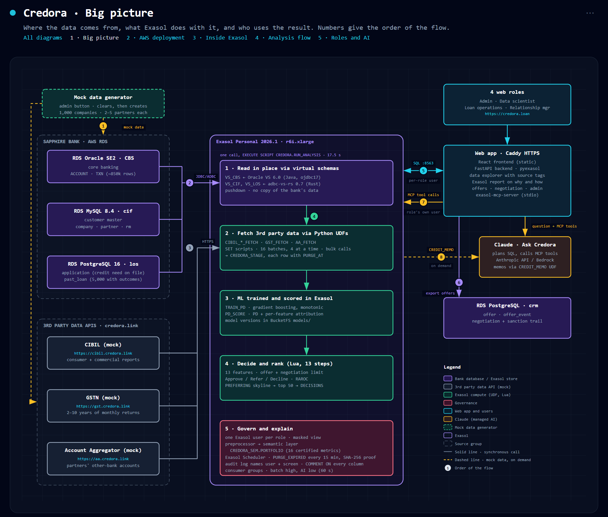
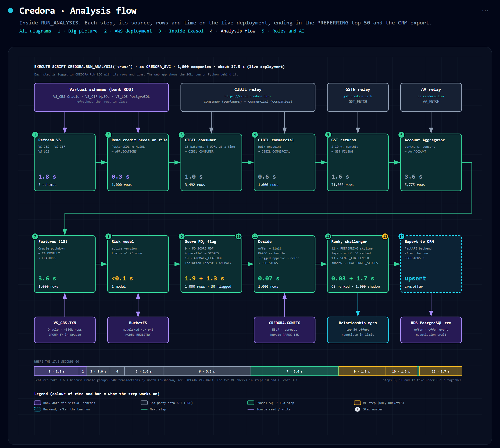
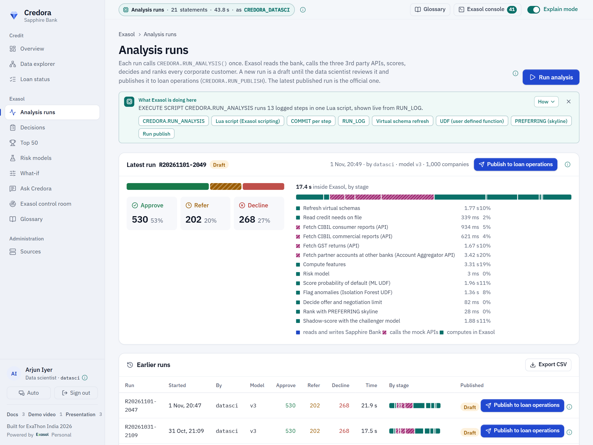
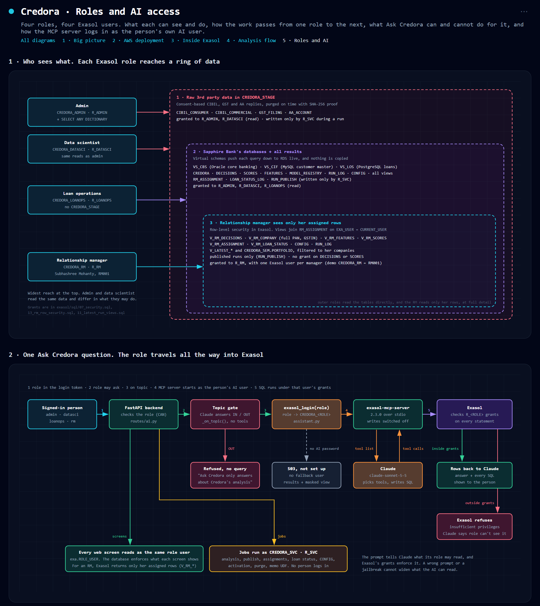
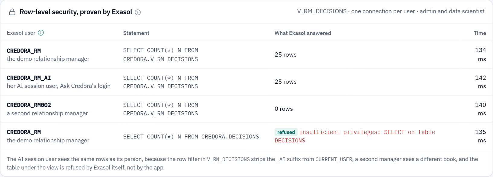
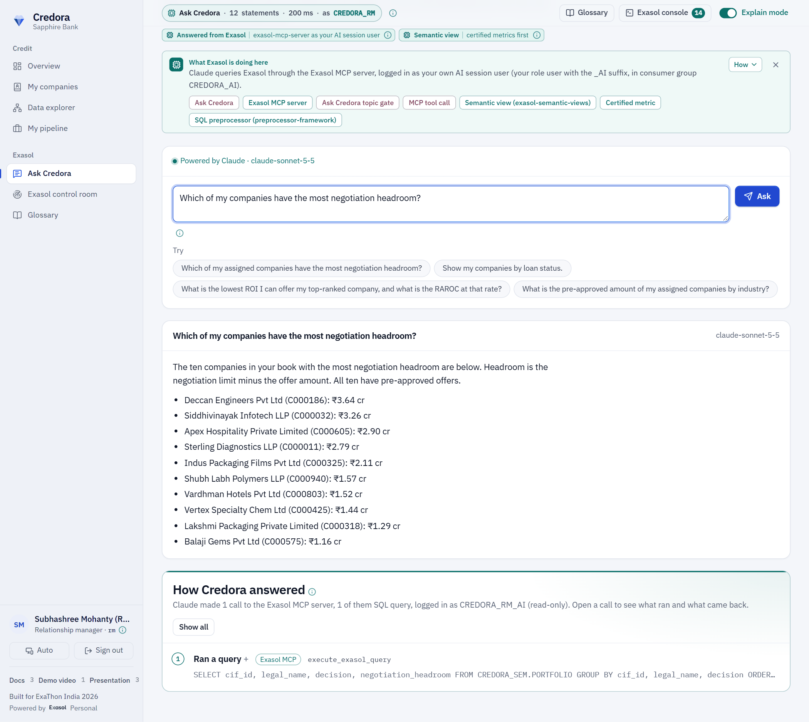
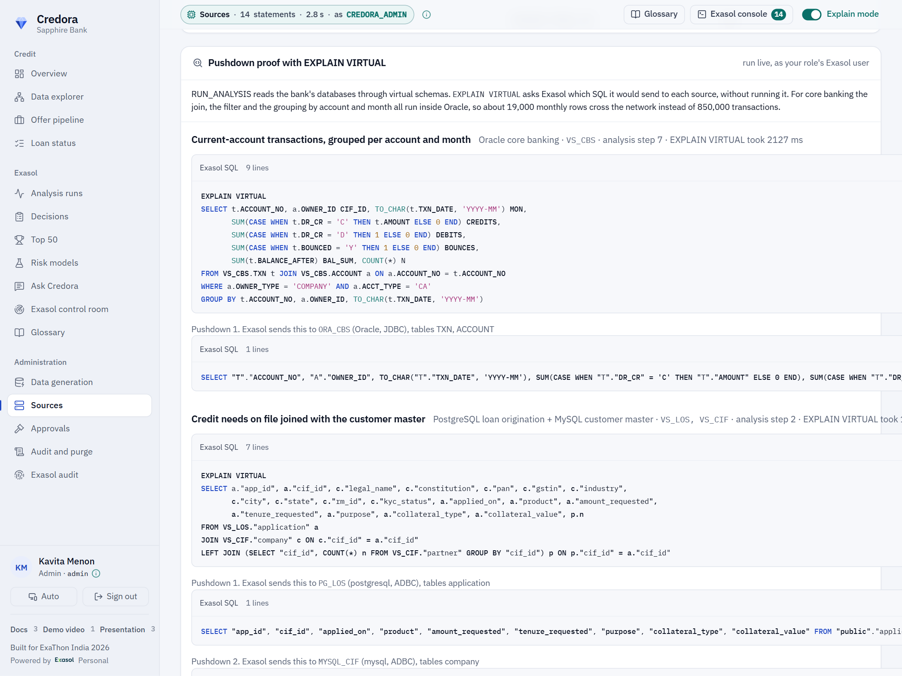

#  Credora

[](https://github.com/anamika-iit-kgp/credora/actions/workflows/ci.yml)
[](LICENSE)
[](https://github.com/exasol-labs/exasol-personal-local-starterkit)
[](https://github.com/exasol/exasol-personal)
[](https://credora.loan)

Credora helps a bank lend to its own business customers before they ask. For every corporate customer of Sapphire Bank it decides whether to make a pre-approved loan offer, sets the amount, rate and tenure, and sets how far the relationship manager may negotiate. All of the analysis runs inside Exasol Personal, where the bank's data already meets.

It is live. The links below are the real deployment, including the demo video.

| Site | Link |
|---|---|
| Live app | https://credora.loan |
| Docs | https://docs.credora.loan |
| Presentation | https://ppt.credora.loan, and [media/presentation.pdf](media/presentation.pdf) in this repository |
| Demo video | https://video.credora.loan, and [media/demo.mp4](media/demo.mp4) in this repository |
| 3rd party data, fetched on demand via API (mock CIBIL, GSTN and Account Aggregator APIs) | https://credora.link |
| Source code | https://github.com/anamika-iit-kgp/credora |

Sign in with one click on the login page, or use a demo login. All data is synthetic, so the passwords are public.

- `admin` / `Demo@123` is the bank manager, who approves models and policy.
- `datasci` / `Demo@123` is the data scientist, who runs the analysis and publishes it.
- `loanops` / `Demo@123` is loan operations, who assigns companies to relationship managers.
- `rm` / `Demo@123` is Subhashree Mohanty (`RM001`), a relationship manager who sees only her own companies.

## Submission at a glance

| ExaThon asks for | Where it is |
|---|---|
| A clear problem statement | [The problem](#the-problem) |
| A working solution using Exasol Personal | [The solution](#the-solution), live at https://credora.loan, and [Exasol features used](#exasol-features-used) |
| A public code repository | https://github.com/anamika-iit-kgp/credora (MIT licence) |
| Setup and reproduction instructions | [Setup and reproduction](#setup-and-reproduction) |
| Data sources, licences, APIs and third-party tools | [Data sources, licences, APIs and third-party tools](#data-sources-licences-apis-and-third-party-tools) |
| Demonstration video and supporting materials | [Presentation and demo video](#presentation-and-demo-video) |



## The problem

Sapphire Bank's credit team can't make pre-approved offers to the corporate customers it already serves, because the evidence sits in six separate systems and is gathered by hand, one company at a time. If this worked, every corporate customer would be decided in one run, and the relationship manager would call with an offer and a negotiation limit already set.

Banks already hold most of what they need to lend to their existing business customers. Transactions sit in core banking, partner and KYC details in the customer master, and each company's credit need on file in loan origination. Credit bureau, GST and Account Aggregator data can be fetched by API, with the customer's consent.

The trouble is that this data lives in separate systems. A credit team has to gather it by hand, score the risk and price each offer one customer at a time, so good customers wait weeks and some are never approached. Copying everything into yet another system adds cost, delay and data-protection risk.

Credora answers one question for every corporate customer, in one run. Should the bank offer this company a loan, how much, at what rate and for how long, and how far can the relationship manager negotiate? It answers it where the data already is, and each person sees only what their role allows.

## The solution

Sapphire Bank has a large book of corporate current-account customers and wants to approach the best of them with a pre-approved offer. Each offer has an amount, a rate and a tenure, plus a negotiation limit the relationship manager can move within. The data for that sits in the bank's Oracle, MySQL and PostgreSQL databases (including each company's credit need on file) and in 3rd party data via API from CIBIL, GSTN and the Account Aggregator. One call, `EXECUTE SCRIPT CREDORA.RUN_ANALYSIS('<run>')`, reads all six sources in place, scores risk with models trained in Exasol and prices and ranks the companies analysed in 17.5 s.

Credora does all of this inside Exasol Personal, where the data already meets, so the bank can approach its best customers first with a ready offer. The data scientist runs the analysis and publishes it. Loan operations assigns the companies to relationship managers, and each manager negotiates inside the limit and logs the loan status. The admin approves model activations and policy changes. In every role, Ask Credora answers plain-English questions with Claude through the official Exasol MCP server.





## What changes for the bank

On the published run `R20261031-1923`, Credora analysed 1,000 companies and decided 530 APPROVE, 202 REFER and 268 DECLINE. The pre-approved offers to the 530 approved companies total ₹1,168.9 crore, against a credit need on file of ₹1,252.3 crore, with negotiation room up to ₹1,414.2 crore. The Top 50 alone carry ₹258.7 crore of offers at an average rate of 10.82% and a RAROC of 21.2%. A run takes 17.5 s, so the bank can decide its whole corporate book again after every policy change or data refresh. The relationship manager negotiates inside the limit Exasol set for each company. A deal within the limit needs no credit committee round trip, and only a deal beyond it is escalated to loan operations.

## Exasol features used

Credora started on the Exasol Personal Local Starter Kit (`exakit` 0.2.3, with the Exasol MCP server 2.3.0, `exapump` 0.13.1 and `pyexasol`). It was then deployed on AWS with the Exasol Personal launcher 2.3.0, running Exasol 2026.1.0 on an `r6i.xlarge`.

| Exasol feature | Where Credora uses it |
|---|---|
| Virtual schemas | `VS_CBS` (Oracle adapter 6.0, Java), `VS_CIF` and `VS_LOS` (adbc-vs-rs 0.7, Rust) read the three bank databases live, with pushdown. Nothing is copied. |
| `EXPLAIN VIRTUAL` | The Sources screen shows the SQL Exasol sends to each database. The aggregation over 850,000 transactions runs inside Oracle. |
| Script language containers | Built-in Python 3 and Java, plus the exasol-labs Rust container (language-container-rs release 0.23.1) uploaded to BucketFS |
| BucketFS | The Rust container, the adapter library, JDBC drivers and every trained model |
| Python UDFs (SET and SCALAR) | Fetch CIBIL, GST and Account Aggregator data in 16 batches, which Exasol runs 4 at a time on the node's 4 cores, with 3 retries per call. Train and score the risk models, and write credit memos with Claude |
| CONNECTION objects | API endpoints and keys, the BucketFS location and the AI provider, so no secret is in code |
| In-database ML | A gradient-boosting champion, a logistic-regression challenger scored in the shadow and an Isolation Forest anomaly flag. `MODEL_REGISTRY` holds a SHA-256 of each model file, which `PD_SCORE` checks before unpickling Every model's calibration on the training's own hold-out (deciles, Brier score, AUC) and every run's feature stability against the past loans (PSI) are computed inside Exasol and shown on the Risk models screen, see [docs/MODEL_VALIDATION.md](docs/MODEL_VALIDATION.md). |
| Pricing inside Exasol | Offers are priced with an industry cash margin table, an LGD per collateral type and a cap on total exposure after the offer, all read inside Exasol and written out in [docs/PRICING.md](docs/PRICING.md). |
| Lua scripting | `RUN_ANALYSIS` runs 13 logged steps as one call, and a failed step stays in `RUN_LOG` with its error. `TRAIN_MODEL` and `PURGE_EXPIRED` (a SHA-256 fingerprint per 1,000-row chunk) are Lua too. |
| Window functions and analytic SQL | Turn core-banking transactions and GST history into 13 credit features |
| `PREFERRING` (skyline) | Ranks the Pareto-best companies into the top 50 |
| Semantic views (exasol-semantic-views 0.5.1) | `CREDORA_SEM.PORTFOLIO` holds 16 certified metrics shared by the app and the AI |
| SQL preprocessor (preprocessor-framework 0.9.1) | Routes semantic SQL per role and skips a failing module |
| Preprocessor library (preprocessor-library 0.3.1) | `cast_shorthand` and `trailing_comma` for the roles that send AI-written SQL |
| Users, roles and GRANTs | One Exasol user per app role, plus one AI user per person with the same role (`CREDORA_ADMIN_AI`, `CREDORA_DATASCI_AI`, `CREDORA_LOANOPS_AI`, `CREDORA_RM_AI`), so the database decides what each screen and the AI can read |
| Row-level security views | The relationship manager's views filter on `CURRENT_USER`. The control room proves it by running the same SELECT as `CREDORA_RM`, `CREDORA_RM_AI` and `CREDORA_RM002` |
| SQL audit (`EXA_DBA_AUDIT_SQL`, `EXA_DBA_AUDIT_SESSIONS`) | Every statement is tagged `credora:<app user>:<feature>` and shown on the admin's Exasol audit screen. `IDENTIFIED BY` secrets are masked with `REGEXP_REPLACE` inside Exasol, before the text leaves the database |
| `COMMENT ON` | Every Credora schema, table, column and script carries its meaning, which the MCP server hands to the AI |
| Consumer groups and `QUERY_TIMEOUT` | `CREDORA_BATCH` runs the analysis first. The AI users sit in `CREDORA_AI`, with low priority, a 60 s statement limit and 2 GiB of temp memory, so the AI cannot starve the analysis. |
| Exasol Scheduler (exasol-scheduler 0.4.1) | A container on the app host that reads its tasks from `SCHED.SCHED_TASKS` in Exasol. It runs `PURGE_EXPIRED` every 15 minutes and refreshes the virtual schemas nightly, with every run logged in `SCHED.SCHED_HISTORY` |
| System tables | Audit, connections, columns, virtual schemas, scripts, grants and sessions feed the admin screens |
| Exasol MCP server (exasol-mcp-server 2.3.0) | Ask Credora queries Exasol as the signed-in person's own AI user, with the same role and writes switched off |
| Exasol console and control room (Explain mode) | The console lists each statement a screen sent to Exasol, with the user it ran as. The control room maps the database as that role sees it. A permanent Exasol strip in the top bar shows the screen, its statements, their time and the Exasol user, and opens the console. |
| Exasol Personal launcher | Installs Exasol on EC2 with one command, its ports open to admin IPs only |

Each feature, with its code and the reason for it, is in [docs/WHY_EXASOL.md](docs/WHY_EXASOL.md).

## Roles, enforced by Exasol

Every app role reads Exasol as its own database user. The backend runs each screen's queries as that user. Ask Credora starts the MCP server logged in as the person's own AI user (`CREDORA_ADMIN_AI`, `CREDORA_DATASCI_AI`, `CREDORA_LOANOPS_AI` or `CREDORA_RM_AI`), which holds the same role and sits in the `CREDORA_AI` consumer group with a 60 s statement limit and 2 GiB of temporary memory. The admin's AI user has no dictionary access, so the AI cannot read the audit log. A role with no AI password gets a 503, with no fallback user. When Exasol refuses a query, the screen shows `403 Exasol denied access for your role`. Analysis, training and the purge run as the service user `CREDORA_SVC`.

| Login | Exasol user and role | What the app shows | What Ask Credora can read |
|---|---|---|---|
| `admin` | `CREDORA_ADMIN` / `R_ADMIN` | Data generation, sources, approvals, audit and purge, Loan status | Results, the semantic view, the three bank databases and raw 3rd party data, without the audit log |
| `datasci` | `CREDORA_DATASCI` / `R_DATASCI` | Runs and publishes the analysis, trains models, what-if and policy proposals | Same as admin |
| `loanops` | `CREDORA_LOANOPS` / `R_LOANOPS` | Published runs, assigning companies to managers, sanctioning escalations | Same as admin, without raw 3rd party data (`CREDORA_STAGE`) |
| `rm` | `CREDORA_RM` / `R_RM` | Only her assigned companies, at full detail, with negotiation and loan status | Only the row-filtered `V_RM_*` and `V_LATEST_*` views |

The RM logs the loan status one step at a time, from Contacted to Disbursed. Loan taken needs terms agreed within the negotiation limits or sanctioned by loan operations ([docs/API.md](docs/API.md#loan-status-state-machine)).

The `V_RM_*` views join `CREDORA.RM_ASSIGNMENT` on the logged-in Exasol user (an AI session user `<person>_AI` counts as its person), and `R_RM` has no grant on the result tables. Signed in to Exasol as `CREDORA_RM`, `V_RM_DECISIONS` returns her 25 companies and `SELECT * FROM CREDORA.DECISIONS` fails with "insufficient privileges". A prompt can't widen that, because the limit lives in the database. The control room panel "Row-level security, proven by Exasol" (`GET /api/admin/rls-proof`) runs that SELECT as `CREDORA_RM`, as her AI user `CREDORA_RM_AI` and as a second manager, `CREDORA_RM002`, and shows each result and each refusal.



## Verify it yourself

Every feature below can be tried on https://credora.loan and found in the code.

| Feature | Where to click | Code |
|---|---|---|
| The whole analysis is one Exasol call | `datasci`, Analysis runs, Run analysis, then any company report. "How Exasol decided" sits above the credit memo with the decision step open, and the 13 steps show their SQL, Lua or Python and their time | [06_run_analysis.sql](exasol/lua/06_run_analysis.sql) |
| Bank data is read in place | `admin`, Sources | [03_virtual_schemas.sql](exasol/sql/03_virtual_schemas.sql) |
| Oracle does the heavy aggregation | `admin`, Sources, Pushdown proof (`EXPLAIN VIRTUAL`) | [exasol_admin.py](backend/app/exasol_admin.py) |
| Exasol UDFs fetch the 3rd party data via API | https://credora.link shows the relays the UDFs call | [04_api_udfs.sql](exasol/udf/04_api_udfs.sql) |
| An API call retries before it fails | Each UDF call makes 3 attempts, with 1 s and 2 s pauses, then fails with an error that names the service, which the run log shows | [04_api_udfs.sql](exasol/udf/04_api_udfs.sql) |
| A failed step stays visible | `datasci`, Analysis runs. A step that fails is committed to `RUN_LOG` with its error before the run stops, so the run list shows it | [06_run_analysis.sql](exasol/lua/06_run_analysis.sql) |
| Models are trained and scored in Exasol | `datasci`, Risk models, Train champion and challenger | [05_ml_udfs.sql](exasol/udf/05_ml_udfs.sql) |
| A model file is checked before it is loaded | `datasci`, Risk models shows each version's SHA-256 (`MODEL_REGISTRY.MODEL_SHA256`, also in `GET /api/ml/models`). `PD_SCORE` hashes the file in BucketFS and refuses a mismatch before unpickling | [05_ml_udfs.sql](exasol/udf/05_ml_udfs.sql) |
| Exasol filters the relationship manager's rows | `rm`, My companies lists 25 companies. Any other company's report returns 403, and the screen shows "Exasol refused this read for CREDORA_RM" with the refused SQL | [13_rm_row_security.sql](exasol/sql/13_rm_row_security.sql) |
| The row filter is proved across users | `admin`, Exasol control room, panel "Row-level security, proven by Exasol". The same SELECT runs as `CREDORA_RM`, `CREDORA_RM_AI` and `CREDORA_RM002` | [exasol_admin.py](backend/app/exasol_admin.py) `GET /api/admin/rls-proof` |
| Ask Credora runs as your own AI user | Ask the same cross-database question as `admin`, then as `rm`. The Exasol audit shows the session as `CREDORA_RM_AI` | [assistant.py](backend/app/assistant.py) |
| Every hand-off is maker-checker | Send a policy proposal as `datasci`, approve it as `admin` under Approvals | [policy.py](backend/app/policy.py) |
| The database records who ran what | `admin`, Exasol audit | [exa.py](backend/app/exa.py) `client_tag()` |
| 3rd party data is purged on schedule, with proof | `admin`, Exasol audit (scheduler runs), then Audit and purge. The fingerprint is a SHA-256 per 1,000-row chunk (72 chunks of up to 33,325 characters for one run's GST rows, far under the 2,000,000-character limit), and the purge skips while an analysis logged a step in the last 3 minutes | [08_purge.sql](exasol/lua/08_purge.sql), [17_scheduler.sql](exasol/sql/17_scheduler.sql) |
| The AI can't starve the analysis | Ask Credora sessions appear in Exasol audit as `credora:<role>:ask-credora`, under the AI user and the `CREDORA_AI` consumer group | [16_resources.sql](exasol/sql/16_resources.sql) |
| Every click shows what Exasol does | Explain mode, the Exasol strip in the top bar (screen, statements, time, Exasol user), the Exasol console and the Exasol control room | [console.py](backend/app/console.py), [explain/](frontend/src/explain/) |
| The Overview walks you through the demo | Any role, Overview, the four-step demo rail and its Switch role menu. Explain mode shows one toast at a time, for 10 s, and one band per screen per session | [Overview.tsx](frontend/src/pages/Overview.tsx) |
| Everything rebuilds from this repo | One command in any AWS account | [credora.py](deploy/credora.py) |







About the AUC. The champion scores AUC 0.756 (Gini 0.512) and the challenger scorecard 0.769 (Gini 0.538), both on the same hold-out of the 5,000 past loans, which have a 7.5% default rate. The numbers sit near the ceiling the synthetic data allows. The generator ([risk.py](mocks/generator/generator/risk.py)) draws each default from Bernoulli(sigmoid(-3.05 + 1.25 z)), where z is the company's hidden risk, so even a model that knew z exactly would score about 0.78. The scorecard beats the trees because that relationship is logistic and linear in z, and 5,000 loans favour the simpler model.

## Setup and reproduction

### Try it in two minutes, no AWS

The web app runs on its own with synthetic fixtures in the browser, so you can click through every screen and every role without a backend or a database.

```bash
cd frontend
npm install
npm run dev:fixtures
```

Open http://localhost:5173. Any password works, the demo-user buttons sign in at once, and `?as=admin`, `?as=datasci`, `?as=loanops` or `?as=rm` on any URL signs in as that role. Fixture state lives in the browser's `localStorage` under `credora.fixtures.v2`, so clear it to start over. The fixtures follow the API and the decision logic in the browser. Only the live site runs on Exasol.

### Deploy it to your own AWS account

Everything runs from your own machine against your own AWS account. Nothing in the code is tied to an account or a domain.

1. Install the [Exasol Personal Local Starter Kit](https://github.com/exasol-labs/exasol-personal-local-starterkit), following its README. It brings the `exasol` launcher from [exasol/exasol-personal](https://github.com/exasol/exasol-personal), `uv`, `pyexasol`, `exapump` and the Exasol MCP server. Check it with `exakit version` (Credora was built with 0.2.3) and `exasol version`.
2. Install the AWS CLI v2, Docker, Python 3.12, Node.js 22 and Git.
3. Log in to AWS, and have a Route 53 hosted zone in that account. The default sizes need 6 vCPUs of on-demand EC2.
   ```bash
   aws configure --profile mysite
   aws sts get-caller-identity --profile mysite
   ```
4. Clone the repo and install the deploy tool.
   ```bash
   git clone https://github.com/anamika-iit-kgp/credora.git
   cd credora
   make setup   # or: uv venv deploy/.venv && uv pip install -p deploy/.venv -r deploy/requirements.txt
   ```
5. Copy `.env.example` to `.env.mysite` and fill it in. The name after `.env.` is the deployment name.

   | Variable | Set it to | Required |
   |---|---|---|
   | `AWS_PROFILE` | The profile from step 3 | yes |
   | `AWS_REGION` | Your region, for example `ap-south-1` | yes |
   | `DOMAIN` | Your Route 53 hosted zone, for example `mybank.example` | yes |
   | `EXTERNAL_DOMAIN` | A second hosted zone for the 3rd party data APIs | no |
   | `ADMIN_CIDR` | Your IP as `x.x.x.x/32` (blank detects it) | no |
   | `APP_*_PASSWORD` | Demo login passwords (blank means `Demo@123`) | no |
   | `AI_PROVIDER`, `ANTHROPIC_API_KEY`, `AI_MODEL`, `BEDROCK_MODEL_ID` | `anthropic` with your key, or `bedrock` with the app host's instance role and no key (blank turns the AI off) | no |

6. Deploy, then write every URL, login and password to `deployments/mysite/ACCESS.md`.
   ```bash
   python deploy/credora.py deploy --env mysite
   python deploy/credora.py access --env mysite
   ```

`deploy` is idempotent. It installs Exasol through the launcher, creates the RDS databases, app host and DNS with OpenTofu, starts the containers, generates 1,000 companies and sets up every Exasol object. Database and API passwords are generated into AWS Secrets Manager. Other commands (`status`, `infra`, `ship`, `exasol`, `generate`, `destroy`) and moving a deployment to another machine are in [docs/PORTING.md](docs/PORTING.md).

### Cost and time

| Item | Default size | On-demand price in `ap-south-1` |
|---|---|---|
| Exasol node | `r6i.xlarge` | $0.26 an hour |
| App host | `t3.large` | $0.0896 an hour |
| Core banking | RDS Oracle SE2, `db.t3.small`, licence included | $0.072 an hour |
| Customer master | RDS MySQL, `db.t4g.micro` | $0.021 an hour |
| Loan origination | RDS PostgreSQL, `db.t4g.micro` | $0.021 an hour |

Roughly $0.46 an hour for the instances, about $11 a day, plus small charges for gp3 storage, the Elastic IP, Route 53 and S3. Prices are from the AWS Price List API on 1 November 2026. A full deploy takes about 45 minutes, most of it waiting for RDS and the Exasol launcher. `python deploy/credora.py destroy --env mysite` removes everything the deployment created.

### Running pieces locally on the starter kit

These run on a laptop without AWS and without Exasol.

- The mock APIs and the generator. `docker compose -f mocks/docker-compose.dev.yml up -d --build`, then `curl -X POST localhost:8100/generate -H 'content-type: application/json' -d '{"seed": 42}'` ([mocks/README.md](mocks/README.md)).
- The backend tests, which include the atomic job guard, the busy pool mapped to 503, the overview count cache and the audit mask. `pip install -r backend/requirements-dev.txt`, then `python -m pytest -q` in `backend/`.
- The UDF tests, which run the deployed UDF code in exasol/udf-mock-python. They cover both trainers and the SHA-256 they emit, `PD_SCORE` refusing a mismatched hash, `MODEL_FILE_SHA256`, `ANOMALY_FLAG` and the retry helper of all four fetch UDFs. `pip install -r tests/udf/requirements.txt`, then `python -m pytest -q` in `tests/udf/`.
- The generator tests. `python -m pytest -q tests` in `mocks/generator/`.
- The web app on fixtures, as above.

These need a local Exasol from the [starter kit](https://github.com/exasol-labs/exasol-personal-local-starterkit).

- The SQL, Lua and UDF files in `exasol/`. [deploy/sql_runner.py](deploy/sql_runner.py) is a small module. `run_file(connection, path, values)` fills the `${VAR}` placeholders, splits the file into statements (a `CREATE SCRIPT` body ends at a line holding `/`) and runs them over `pyexasol`.
- The Python UDFs, in the kit's built-in Python 3 container. The API UDFs need the mock APIs above reachable from Exasol, and the ML UDFs need a BucketFS bucket for the model files.

These need AWS.

- [deploy/exasol_setup.py](deploy/exasol_setup.py) uploads the Rust container, the adapters and the drivers to BucketFS over SSH to the Exasol node, and needs the node's private IP.
- The virtual schemas `VS_CBS`, `VS_CIF` and `VS_LOS` read the three RDS databases, so they exist only on a deployment.

The tests also run in [GitHub Actions](.github/workflows/ci.yml) on every push, and [CONTRIBUTING.md](CONTRIBUTING.md) lists the commands.

### Known limitations

- All data is synthetic, from the generator, and the models learn synthetic labels. The AUC says more about the generator than about real credit risk.
- Exasol runs on one node. Nothing has been measured on a cluster.
- There is one demo relationship manager login, `rm` as `RM001`, plus one extra manager user in Exasol, `CREDORA_RM002`, used by the row-level security proof.
- The offer carries no KFS or APR fields.

### Troubleshooting

- `VS_CBS` fails with an unknown-host error for the RDS endpoint, often after an Exasol restart. The java-17 script language container has no `/etc/resolv.conf` or `/etc/hosts`. Run [exasol/hotfix/slc_dns_fix.sh](exasol/hotfix/slc_dns_fix.sh) on the node over SSH. It links both files to the node's `/conf` copies inside the container. Run it again after every Exasol restart.
- A deploy that stopped part way can be run again. `deploy` is idempotent.
- Exasol or SSH refuses your new IP. `python deploy/credora.py allow-ip --env mysite` opens them to this machine.
- Ask Credora answers 503. The MCP server process failed. Ask again, because each question starts a fresh process.
- A purge run shows SKIPPED. An analysis was in progress, and the next scheduled run purges.

## Data sources, licences, APIs and third-party tools

All data is synthetic and made by Credora's own generator ([mocks/generator](mocks/generator)), with seed 2026 on the live site. The live data set starts at 1,000 companies, and the admin can add more with one click. Sapphire Bank, its companies, their partners, accounts, transactions, GST returns and credit reports are invented. No real person, company or bank record is used. The generator can replace the data set or add more companies with unique names, PANs, GSTINs and account numbers.

| Source | What it holds | Where it lives | How Exasol reads it |
|---|---|---|---|
| Core banking | Accounts and about 850,000 transactions | Amazon RDS for Oracle (SE2, licence included) | Virtual schema `VS_CBS` |
| Customer master | Companies, partners, relationship managers, KYC | Amazon RDS for MySQL 8.4 | Virtual schema `VS_CIF` |
| Loan origination | Each company's credit need on file and 5,000 past loans | Amazon RDS for PostgreSQL 16 | Virtual schema `VS_LOS` |
| CIBIL (credit bureau) | Partner and company credit reports | Mock API at https://cibil.credora.link | Python UDFs over HTTPS |
| GSTN | GST registrations and monthly returns | Mock API at https://gst.credora.link | Python UDFs over HTTPS |
| Account Aggregator | Consented accounts at other banks | Mock API at https://aa.credora.link | Python UDFs over HTTPS |

The three mock APIs are written for this project ([mocks/](mocks)). They follow the shape of the real services, but no real CIBIL, GSTN or Account Aggregator API is called, and no credentials for them are needed. Their contracts are in [docs/API.md](docs/API.md).

Ask Credora and the credit memos call Claude through the Anthropic API (model `claude-sonnet-5-5`), under Anthropic's commercial terms. Amazon Bedrock can be used instead. Without an AI key the rest of the app works.

The third-party tools and their licences are below.

| Tool | Used for | Licence |
|---|---|---|
| Exasol Personal 2026.1 | The analytics database | Free for personal use, under Exasol's terms. The launcher is MIT |
| Exasol open source projects (see the thank-you table below) | Virtual schemas, script languages, semantic views, preprocessors, scheduler, MCP server, drivers | MIT, except script-languages-release, which is GPL-3.0 |
| Oracle Database SE2, MySQL, PostgreSQL | The bank's source databases on Amazon RDS | Licence included in RDS (Oracle), GPL-2.0 (MySQL), PostgreSQL Licence |
| scikit-learn, NumPy | ML models inside Exasol UDFs | BSD-3-Clause |
| FastAPI, Uvicorn, httpx, PyJWT, psycopg, PyMySQL, python-oracledb, boto3 | The backend and the mock APIs | MIT, BSD, LGPL-3.0 (psycopg), Apache-2.0 (oracledb, boto3) |
| Anthropic Python SDK, MCP Python SDK | Ask Credora and credit memos | MIT |
| React, React Router, TanStack Query, Motion, Lucide icons | The web app | MIT, ISC (Lucide) |
| IBM Plex and Literata fonts | Typography | SIL Open Font Licence 1.1 |
| OpenTofu, Caddy, Docker | Infrastructure as code, HTTPS, containers | MPL-2.0, Apache-2.0, Apache-2.0 |
| AWS (EC2, RDS, S3, Route 53, Secrets Manager) | Hosting, in my own AWS account | AWS customer agreement |

Exasol, Oracle, MySQL, PostgreSQL and other names and logos belong to their owners and appear only to identify the systems used. Credora's own code is MIT licensed.

## Presentation and demo video

Both are in this repository and on their own sites, so a person or an evaluation tool can read them either way.

| Material | In this repository | Live |
|---|---|---|
| Demo video, 2 min 56 s with a voice-over | [media/demo.mp4](media/demo.mp4), 1080p with the captions burned in, compressed for the repository. GitHub plays it on the file page. | https://video.credora.loan plays the full quality copy, with captions the viewer can switch on. Direct file https://video.credora.loan/demo.mp4 |
| What the video says | [media/demo-transcript.md](media/demo-transcript.md), one row per scene with the narration, plus [media/demo.srt](media/demo.srt) and [media/demo.vtt](media/demo.vtt) | https://video.credora.loan/demo.vtt |
| Presentation, 22 slides | [media/presentation.pdf](media/presentation.pdf). GitHub shows it on the file page. | https://ppt.credora.loan, animated, and https://ppt.credora.loan/presentation.pdf to download |
| Live app with four demo logins | | https://credora.loan |
| Docs site, with the architecture and glossary | [docs/](docs/) | https://docs.credora.loan |
| 3rd party data APIs | [mocks/](mocks/) | https://credora.link |
| Architecture diagrams | The table below and [docs/diagrams](docs/diagrams/index.html) | https://docs.credora.loan |

The docs, presentation and video sites each show a simple view count, also listed next to their links in the app. Only one number per site is stored, nothing about visitors. The video page serves `demo-hq.mp4` when one sits next to `demo.mp4`, otherwise `demo.mp4`, and a `video.json` next to the page can point it at a file hosted elsewhere. A higher quality copy can be published without entering the repository.

## Diagrams

| Diagram | Image | Interactive |
|---|---|---|
| Big picture | [PNG](docs/img/01-big-picture.png) | [HTML](docs/diagrams/01-big-picture.html) |
| AWS deployment | [PNG](docs/img/02-aws-deployment.png) | [HTML](docs/diagrams/02-aws-deployment.html) |
| Inside Exasol | [PNG](docs/img/03-inside-exasol.png) | [HTML](docs/diagrams/03-inside-exasol.html) |
| Analysis flow | [PNG](docs/img/04-analysis-flow.png) | [HTML](docs/diagrams/04-analysis-flow.html) |
| Roles and AI access | [PNG](docs/img/05-roles-access.png) | [HTML](docs/diagrams/05-roles-access.html) |

The full design, with failure modes and trade-offs, is in [docs/architecture.html](docs/architecture.html).

## Repository layout

```
exasol/     SQL, Python UDFs, Lua scripts, preprocessor modules and the semantic model
backend/    FastAPI with roles, jobs, Ask Credora and the Exasol audit
frontend/   React and TypeScript, with Explain mode
mocks/      mock CIBIL, GSTN and Account Aggregator APIs and the data generator
deploy/     the one-command deploy tool, with infra/ (OpenTofu) beside it
docs/       architecture, diagrams, glossary, data model, APIs, porting
```

## Documentation

| Document | Covers |
|---|---|
| [docs.credora.loan](https://docs.credora.loan) | The live docs site |
| [docs/architecture.html](docs/architecture.html) | The full design, roles, decision logic, deployment and failure modes |
| [docs/WHY_EXASOL.md](docs/WHY_EXASOL.md) | Every Exasol feature used, where and why |
| [docs/GLOSSARY.md](docs/GLOSSARY.md) | Every Exasol, banking, AI and AWS term in plain words |
| [docs/DATA_MODEL.md](docs/DATA_MODEL.md) | Bank schemas, mock API data and feature definitions |
| [docs/API.md](docs/API.md) | The mock API contracts and the web app's API |
| [docs/PORTING.md](docs/PORTING.md) | Deploying to another AWS account or domain |

## Built with Exasol open source, thank you

Every project below runs in the live deployment or in CI. Thank you to the Exasol team and to everyone who contributes to them.

| Project | What it does in Credora |
|---|---|
| [exasol-labs/exasol-personal-local-starterkit](https://github.com/exasol-labs/exasol-personal-local-starterkit) | The starter kit (`exakit` 0.2.3) Credora began on, with local Exasol, MCP setup, `exapump` and `pyexasol` |
| [exasol/exasol-personal](https://github.com/exasol/exasol-personal) | Exasol Personal and its launcher, which deploys the database on AWS |
| [exasol/oracle-virtual-schema](https://github.com/exasol/oracle-virtual-schema) | `VS_CBS`, core banking in RDS Oracle, read live with pushdown |
| [exasol-labs/adbc-vs-rs](https://github.com/exasol-labs/adbc-vs-rs) | `VS_CIF` and `VS_LOS`, the MySQL and PostgreSQL databases, read live through ADBC |
| [exasol-labs/language-container-rs](https://github.com/exasol-labs/language-container-rs) | The Rust script language container that runs the adbc-vs-rs adapter |
| [exasol/script-languages-release](https://github.com/exasol/script-languages-release) | The Python 3 and Java containers behind the API, ML and AI UDFs |
| [exasol-labs/exasol-semantic-views](https://github.com/exasol-labs/exasol-semantic-views) | `CREDORA_SEM.PORTFOLIO`, the certified metrics for the app and the AI |
| [exasol-labs/preprocessor-framework](https://github.com/exasol-labs/preprocessor-framework) | Owns the SQL preprocessor slot and routes semantic SQL per role |
| [exasol-labs/preprocessor-library](https://github.com/exasol-labs/preprocessor-library) | `cast_shorthand` and `trailing_comma` (0.3.1) for AI-written SQL |
| [exasol-labs/exasol-scheduler](https://github.com/exasol-labs/exasol-scheduler) | Release 0.4.1 runs the purge every 15 minutes and the nightly virtual schema refresh |
| [exasol/udf-mock-python](https://github.com/exasol/udf-mock-python) | Tests the deployed `ANOMALY_FLAG` and `PD_SCORE` UDF code in CI |
| [exasol/mcp-server](https://github.com/exasol/mcp-server) | `exasol-mcp-server` 2.3.0, through which Ask Credora queries Exasol |
| [exasol/pyexasol](https://github.com/exasol/pyexasol) | The Python driver for the backend and the deploy tool |
| [exasol-labs/exapump](https://github.com/exasol-labs/exapump) | The starter kit's SQL and bulk-load CLI |
| [exasol/virtual-schemas](https://github.com/exasol/virtual-schemas) | The virtual schema framework the Oracle adapter builds on |

## About, contributing and contact

Credora is an ExaThon India 2026 project, a bank's pre-approved corporate lending, decided inside Exasol Personal. It was built on the Exasol Personal Local Starter Kit and deployed on AWS. The live deployment runs in my own AWS account, on the domains `credora.loan` and `credora.link`, which I registered for this project. This is version 2.0.0, see [CHANGELOG.md](CHANGELOG.md).

Contributions are welcome, see [CONTRIBUTING.md](CONTRIBUTING.md). Security reports go through [SECURITY.md](SECURITY.md), and the [code of conduct](CODE_OF_CONDUCT.md) is short. To build on Credora, adapt it for your bank, or buy or license it, raise an [issue](https://github.com/anamika-iit-kgp/credora/issues) and I will get in touch.

Project by Anamika, Product Manager @ Equitas Small Finance Bank. Sapphire Bank is fictional, and all data is synthetic.

## License

MIT. See [LICENSE](LICENSE).
